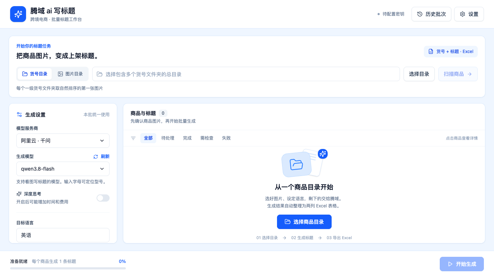

# 腾域 ai 写标题

全中文、蓝白风格的跨境电商标题批处理桌面程序。用 **Python + FastAPI** 处理本地图片与模型调用，通过 **React + pywebview** 显示独立窗口，输出只有「货号、标题」两列的 Excel。

> 当前交付为源代码。仓库包含 Windows 打包脚本和手动构建工作流；尚未发布经过 Windows 安装验收的安装包。真实阿里云调用需要自行在界面中配置 API Key。



## 使用流程

1. 打开右上角「设置」，填写阿里云 API Key 和匹配的服务地址，保存。
2. 选择「货号目录」或「图片目录」，选择文件夹并点击「扫描商品」。
3. 查看所选图片，设置模型、思考开关、目标语言、字符范围和补充要求。
4. 点击「开始生成」。可以暂停、继续，并在任务收尾后选择项目重新生成。
5. 完成后在输入目录找到 Excel，也可以点击「打开结果」。

### 两种目录模式

| 模式 | 示例 | 货号 | 读取规则 |
| --- | --- | --- | --- |
| 货号目录 | `商品总目录/00123/1.jpg` | `00123` | 每个一级货号文件夹取自然排序的第一张图片 |
| 图片目录 | `商品图片/ABC001.jpg` | `ABC001` | 当前目录每张图片生成一条标题 |

自然排序按照 `1、2、10` 排列，不扫描更深层目录。支持 JPG、JPEG、PNG、WebP、BMP；空文件夹、损坏的第一张图片会标记失败，不偷偷改用其他图片。同名不同后缀的图片各自占一行，并提示货号重复。

### 标题与 Excel

- 内置通用标题规则：使用可确认的商品事实，遵守目标语言、字符范围和用户补充要求，不凭图片猜测品牌、材质、尺寸等未知属性。
- 每件商品只请求一次。没有自动修正和自动重试；重新生成由用户明确点击，可能再次计费。
- 按 Unicode grapheme cluster 统计可见字符，空格和标点也计入。
- 保存模型原始正文。导出时只清理首尾空白和连续空格，不自动截断或改写标题。
- 长度不符的标题仍导出，单元格标黄并附批注；失败及待处理项目保留货号，标题为空。
- Excel 文件写入所选总目录，命名为 `标题_日期时间_批次编号.xlsx`。货号与标题都按文本写入，保留前导零并防止内容被当成公式。
- 结果分项保存，退出后可以恢复。请求被打断时标记「结果未知」，不会自动再次调用。
- 批次开始后固定图片、规则和设置。更换图片或服务地址后，请重新扫描创建新批次。

## 技术结构

```text
backend/tengyu/     FastAPI、扫描、任务队列、服务商适配、SQLite、Excel
frontend/src/      React、TypeScript、Tailwind CSS、Base UI
tests/             不调用真实模型的自动化测试
packaging/         pywebview 启动入口、PyInstaller 和 Inno Setup 配置
scripts/           Windows 构建脚本
.github/workflows/ Linux/Windows 代码检查、手动 Windows 打包
```

界面由本机 FastAPI 提供，默认并发 3 个任务，可设置为 1～10。仅启动一个 Uvicorn 进程，通过桌面桥接打开目录和输出文件。API 在每次启动时使用新的随机会话凭证，仅监听 `127.0.0.1`。

### 本地开发（按需自行执行）

需要 Python 3.12、uv、Node.js 24。仓库锁定 Python 和前端依赖；开发者执行下列命令时会安装依赖。

```bash
uv sync --frozen --python 3.12
cd frontend
npm ci
npm run build
cd ..
uv run --no-sync tengyu-title-web
```

终端会显示带一次性连接凭证的本地预览地址。在浏览器打开该地址，凭证会从地址栏移除。浏览器预览时可手动输入本机目录路径；系统目录选择框和打开资源管理器功能需要桌面窗口。

Windows 桌面开发运行：

```powershell
uv run --no-sync tengyu-title
```

Vite 开发服务器：先保持后端运行，再执行 `npm run dev`；首次打开 Vite 地址时附上后端预览地址中的 `#token=...`。仅用于本机开发，不应将后端绑定到公网或局域网。

### 自动化检查

```bash
uv run --no-sync ruff check backend tests
uv run --no-sync pytest -q
cd frontend
npm run build
```

前端交互测试使用模拟 API，可执行 `npm run test:ui`。需事先具备匹配版本的 Playwright Chromium；没有时可按需执行 `npx playwright install chromium`。本次没有新下载浏览器运行环境。

代码检查工作流在推送和 Pull Request 时运行 Linux、Windows 两个环境，测试使用模拟模型，不需要 API Key、不产生模型费用。

### Windows 安装包（手动触发）

GitHub 仓库打开 **Actions → Windows installer (manual) → Run workflow**。成功后下载 `TengyuTitleStudio-Windows-x64` 构建产物。

也可以在装有 uv、Node.js 24 和 Inno Setup 6 的 Windows 64 位构建机运行：

```powershell
.\scripts\build-windows.ps1
```

脚本会先检查代码，再创建安装包。WebView2 引导安装器从微软官方下载，打包前验证 Microsoft Authenticode 签名。用户电脑缺少 WebView2 时，安装器联网补装；已有运行组件则直接安装应用。

安装包默认安装到当前用户目录，建立桌面快捷方式，升级和卸载保留用户配置、任务记录及商品文件。安装包构建成功不等于 Windows GUI 验收完成，仍需在干净的 Windows 10/11 64 位电脑验证安装、显示缩放、凭据读写、打开窗口及卸载。

## 阿里云配置

默认服务地址：`https://dashscope.aliyuncs.com/compatible-mode/v1`。默认预设型号为 `qwen3.8-flash`；切换到其他地域或业务空间时按官方文档填写匹配的地址与密钥。

模型目录使用独立的 `/api/v1/models` 接口，完整翻页并筛选图片输入、文字输出能力。北京地域目录查询可填写业务空间 ID，也可单独填写完整模型目录地址。目录刷新失败保留原列表，不代表模型不可用；目录出现某型号也不代表账号已开通。

支持切换思考的模型显示开关；已知固定思考模式的型号显示固定状态；未知能力跟随模型默认。只有模型最终正文进入标题，思考过程不会混入。

参考文档：[快速入门](https://platform.qianwenai.com/docs/developer-guides/getting-started/introduction)、[模型目录](https://help.aliyun.com/zh/model-studio/list-models)、[图片输入](https://help.aliyun.com/zh/model-studio/vision)、[思考模式](https://platform.qianwenai.com/docs/developer-guides/text-generation/thinking)。

## 增加其他服务商

在 `providers.py` 增加符合 `TextProvider` 的适配器并注册到 `PROVIDERS`，实现 `list_models()` 和 `generate_title()`。通过 `ModelInfo` 声明图片、文字和思考能力；将各家的鉴权、请求格式、错误与返回内容转换为统一结构。

首版界面和凭据设置只有阿里云。增加服务商时还需增加对应设置表单和凭据项，目录、任务队列和 Excel 模块无需重写。普通纯文本模型不能用于本程序的看图标题流程。

## 数据与隐私

- Windows 数据目录：`%LOCALAPPDATA%\TengyuTitleStudio`，SQLite 保存原始标题、设置快照、Skill 版本和请求状态。
- Windows API Key 保存在系统凭据管理器，服务名 `com.tengyu.title-studio`，不写入数据库、Excel、日志或仓库。
- 商品图片仅在调用时发送到用户选定的模型服务，原始图片不会被修改。
- `TENGYU_DATA_DIR` 可指定开发测试的数据目录。不要把真实任务数据库、密钥、商品图片或本地构建目录提交到公开仓库。

当前验证范围见 [验收记录](docs/VALIDATION.md)。
